# Entra ID Identity Governance Lab

Joiner, mover and leaver controls, access by request and approval, separation of duties and access reviews, built and tested in Microsoft Entra ID P2.

The lab uses the fictional Fenwick Valley Health Services from my [Access Review Automation](https://github.com/Leomez17/access-review-automation) and [JML Workflow](https://github.com/Leomez17/jml-workflow-lab) projects. Lab 1 found risky access, Lab 2 stopped it being created, and this lab enforces the same controls in a production identity platform.

## Results

| Control | Test | Result |
| --- | --- | --- |
| Joiner | 9 users created from an HR file; a future joiner created disabled | No access before day one |
| Mover | Daniel Kim moved from Clinical to HR | Clinical access removed, HR access added, within minutes |
| Request and approval | Laura Chen requested supplier maintenance; her manager approved | Access granted with justification and 90-day expiry |
| Separation of duties | Laura moved to Finance, then requested payment approval | **Request blocked** |
| Leaver | James Turner: leave date set, account disabled, sessions revoked | Removed from every group |
| Access review | Manager review of supplier-maintenance access | Leftover access denied and removed |

**Key finding:** dynamic groups follow the department, but access packages do not. When Laura moved, her role groups updated automatically, but she kept supplier-maintenance rights. The separation-of-duties rule prevented the toxic combination, and the access review detected and removed the leftover access.

## Evidence

| | |
| --- | --- |
| Joiners from HR data | 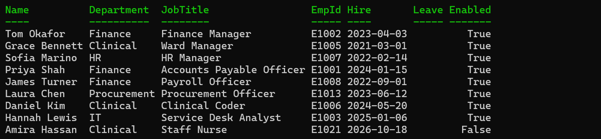 |
| Mover: group membership | 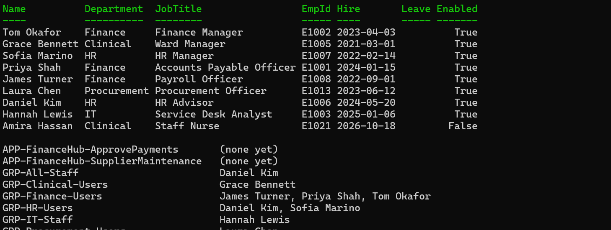 |
| Mover: audit log | 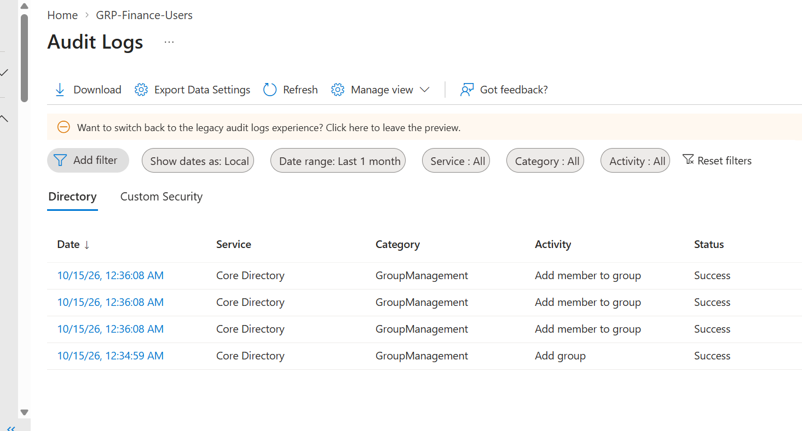 |
| SoD configuration | 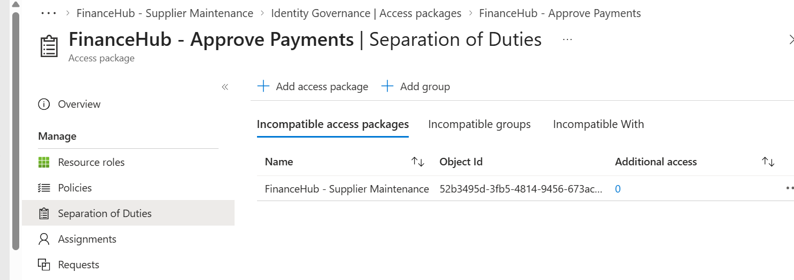 |
| Eligibility by group | 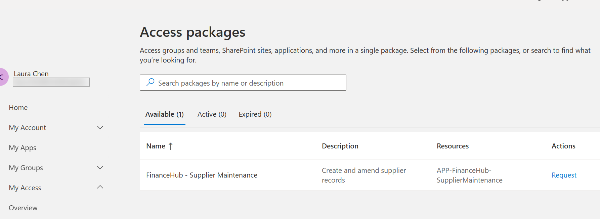 |
| Manager approval | 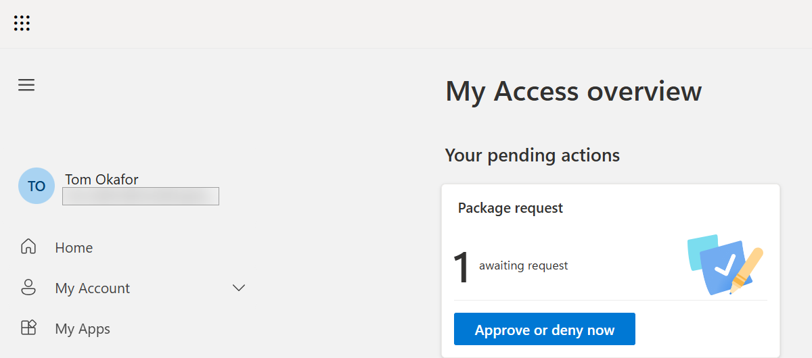 |
| **SoD request blocked** | 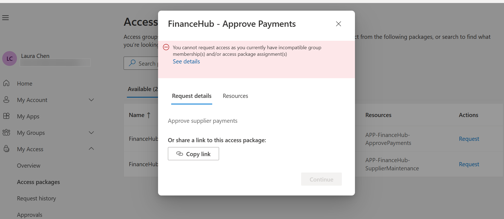 |
| Leaver | 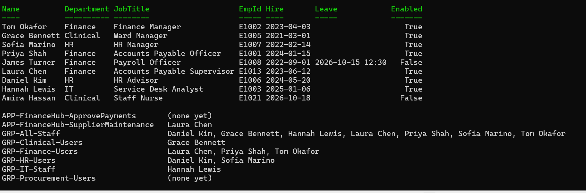 |
| Access review | 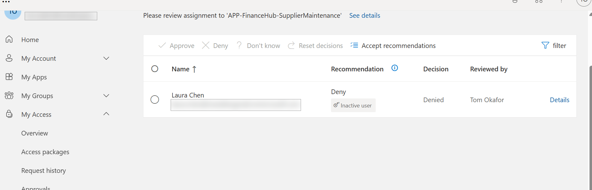 |
| Final state | 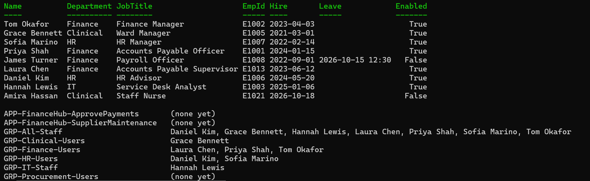 |
| Security defaults block (530035) | 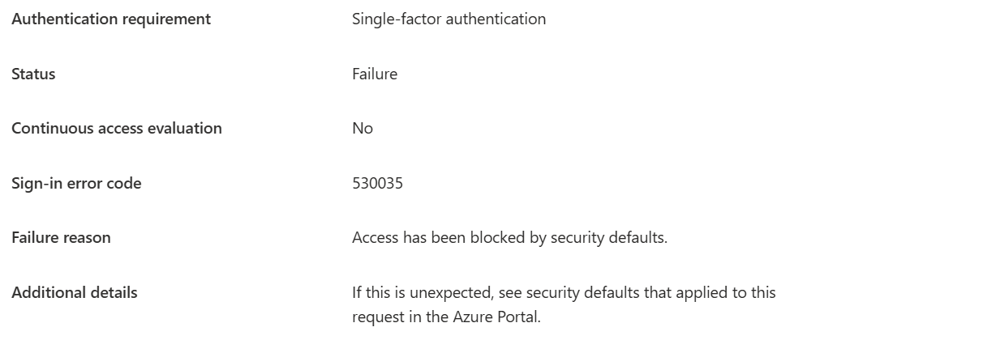 |

Tenant identifiers and email addresses are redacted.

## Design decisions

- Every dynamic group rule requires `accountEnabled -eq true`, so future joiners get nothing before day one and disabled leavers lose all access at once.
- Birthright access (`GRP-All-Staff`) requires an employee ID, so only HR-sourced identities qualify.
- Finance application roles are access packages: requested, approved by the line manager, and expiring after 90 days.
- `FinanceHub - Supplier Maintenance` and `FinanceHub - Approve Payments` are incompatible, so one person cannot create a supplier and approve payments to it.
- Security defaults blocked admin tooling (error 530035), so I replaced them with a Conditional Access policy requiring MFA for administrators.

## Run it

Requirements: PowerShell 7 and the Microsoft Graph modules.

```powershell
Install-Module Microsoft.Graph.Authentication, Microsoft.Graph.Users, Microsoft.Graph.Users.Actions, Microsoft.Graph.Groups, Microsoft.Graph.Identity.DirectoryManagement -Scope CurrentUser
cd scripts
Connect-MgGraph -TenantId "<your-tenant>.onmicrosoft.com" -Scopes "User.ReadWrite.All","User-LifeCycleInfo.ReadWrite.All","Group.ReadWrite.All","Directory.ReadWrite.All","Domain.Read.All" -UseDeviceCode
```

| Script | Purpose |
| --- | --- |
| `01-create-users.ps1` | Create users from `users.csv` with HR attributes and managers |
| `02-assign-licences.ps1` | Assign the tenant's licences |
| `03-create-groups.ps1` | Create the dynamic and FinanceHub groups |
| `04-move-user.ps1` | Mover: change department and job title |
| `05-set-leave-date.ps1` | Leaver: set the HR leave date |
| `06-show-users.ps1 [-Groups]` | Show users and group membership |
| `99-remove-lab.ps1` | Delete the lab users and groups |

Access packages, separation of duties and access reviews are configured in the Entra admin center (ID Governance).

Use a lab tenant only. `01-create-users.ps1` writes temporary passwords to `lab-passwords.csv`, which is in `.gitignore` and should be deleted after the lab.

## Framework mapping

- ISO/IEC 27001:2022 A.5.15, A.5.16, A.5.18, A.8.2, A.8.5
- NCSC Cyber Assessment Framework, principle B2 Identity and access control
- NHS Data Security and Protection Toolkit, user access management
